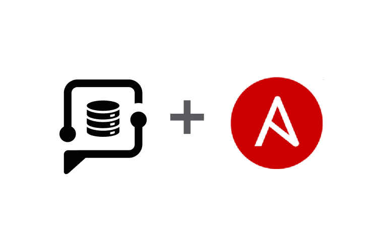

# PidginHost Cloud Ansible Collection



The `pidginhost.cloud` collection manages [PidginHost](https://www.pidginhost.com/) cloud resources through the public API: servers, volumes, snapshots, public and floating IPs, private networks, firewalls, SSH keys, object storage buckets, DNS and Kubernetes clusters. It also ships a dynamic inventory plugin and example playbooks.

Every module supports check mode and makes no changes in it. Tasks leave resources that already match unchanged. Rebooting,
rolling back a snapshot, rotating bucket keys and allocating an IP without an address always make a change.

## Requirements
- ansible-core 2.16 or later. Tested on ansible-core 2.16 and 2.21 (Ansible 14).
- Python 3.9 or later on the host that runs the modules, usually the controller. No extra Python packages.
- A PidginHost API token in `PIDGINHOST_ACCESS_TOKEN` or `PIDGINHOST_TOKEN`, or passed as the `token` option.

## Installation
```bash
ansible-galaxy collection install pidginhost.cloud

# or from this repository
ansible-galaxy collection build
ansible-galaxy collection install ./pidginhost-cloud-<version>.tar.gz
```

## Authentication
```bash
export PIDGINHOST_TOKEN=your-token-here
```
Environment variables keep the token out of playbooks and also work for the inventory plugin. Use `ansible-vault` if the token must live in a file.

## Modules
Run `ansible-doc pidginhost.cloud.<module>` for options and examples.

| Area | Module | Purpose |
| --- | --- | --- |
| Servers | `server` | Create, update or delete a server. Startup script, hardware generation, HA and destroy protection. |
| | `server_action_power` | Start, stop, shut down or reboot a server. |
| | `server_action_resize` | Change a server package, or grow one of its volumes. |
| | `server_snapshot` | Create, delete or roll back to a server snapshot. |
| | `server_rescue` | Boot a server into rescue mode or a catalog ISO, and back. |
| | `servers_info` | List servers, or one server with snapshots, usage, traffic, activity and boot ISOs. |
| | `server_public_ip` | Read the public addresses of a server. |
| | `public_interface_info` | Read the public interface and firewall settings of a server. |
| Storage | `volume` | Create, grow or delete a volume. |
| | `volume_action` | Attach or detach a volume. |
| | `volumes_info`, `volumes_products_info` | List volumes and storage products. |
| | `bucket` | Create, resize, publish or delete an object storage bucket. |
| | `bucket_credentials` | Read or rotate bucket access keys. |
| | `buckets_info` | List buckets. |
| Networking | `ip` | Allocate or release a public IPv4 or IPv6 address and set its reverse DNS. |
| | `ip_action` | Attach or detach a public IP. |
| | `ips_info` | List public IPs. |
| | `floating_ip` | Manage a floating IP, its reverse DNS and the servers allowed to use it. |
| | `floating_ips_info` | List floating IPs. |
| | `private_network` | Create, update or delete a private network. |
| | `private_network_server` | Add a server to a private network or remove it. |
| | `private_networks_info` | List private networks. |
| Firewall | `firewall` | Manage a firewall rules set and its rules. |
| | `firewall_action` | Apply a rules set and default policies to a server. |
| | `firewalls_info` | List rules sets. |
| Account | `ssh_key` | Add, rename or remove SSH keys, optionally removing all others. |
| | `ssh_keys_info`, `profile_info` | List SSH keys and read the account profile. |
| Catalog | `images_info`, `packages_info`, `generations_info` | List OS images, server packages and hardware generations. |
| DNS | `dns_zone` | Turn FreeDNS hosting on or off for a domain. |
| | `dns_record` | Manage A, AAAA, CNAME, MX, SRV, TXT and CAA records, optionally as the only record of its name and type. |
| | `dns_zones_info`, `dns_records_info` | List FreeDNS zones and records. |
| | `domain_nameservers` | Set the nameservers of a registered domain. |
| | `domain_glue_record` | Manage child nameserver hosts registered for a domain. |
| | `domains_info` | List registered domains. |
| Kubernetes | `kubernetes_cluster` | Create, update or delete a cluster: features, protection, worker package and size. |
| | `kubernetes_cluster_upgrade` | Upgrade Kubernetes, Talos, a feature or the load balancer. |
| | `kubernetes_cluster_encryption` | Turn WireGuard encryption of cluster traffic on or off. |
| | `kubernetes_kubeconfig` | Read or regenerate the kubeconfig. |
| | `kubernetes_resource_pool` | Create, resize or delete a worker pool. |
| | `kubernetes_node` | Reboot or remove one worker node. |
| | `kubernetes_route` | Expose a service through an HTTP, TCP or UDP route. |
| | `kubernetes_port_forward` | Forward a load balancer port to an internal address. |
| | `kubernetes_lb_firewall` | Manage the load balancer firewall rules. |
| | `kubernetes_cluster_vm` | Connect a cloud server to the cluster network or disconnect it. |
| | `kubernetes_clusters_info`, `kubernetes_cluster_types_info` | List clusters with their pools, routes and other settings, and the cluster types. |

All modules belong to the `pidginhost.cloud.all` action group, so the token can be set once:
```yaml
- hosts: localhost
  module_defaults:
    group/pidginhost.cloud.all:
      token: "{{ vault_pidginhost_token }}"
  tasks:
    - pidginhost.cloud.server:
        hostname: web1.example.com
        image: ubuntu24
        package: cloudv-2
        ssh_pub_key_id: "123"
        new_ipv4: true
```

## Dynamic inventory
`inventory/pidginhost.yml` is a ready configuration for the `pidginhost.cloud.servers` plugin:
```bash
ansible-inventory -i inventory/pidginhost.yml --graph
```
Each host gets the server attributes as variables and `ansible_user` set to the default user of its image. Use `compose`, `groups` and `keyed_groups` to shape the inventory. The sample caches results in `./tmp/` for five minutes; delete that directory after switching accounts.

## Waiting for changes
Modules with a `wait` option (default `true`) return once the operation has finished, or fail after `timeout` seconds. For
servers, snapshots, buckets and Kubernetes clusters, running a task again while an earlier operation is still in progress waits for it instead of
starting another one.

Kubeconfig and bucket credential results contain secrets. Set `no_log: true` on the tasks that read or use them.

## Example playbooks
`playbooks/` holds one short playbook per module family. `playbooks/profile_info.yml` is a safe first run that only reads the account profile:
```bash
ansible-playbook playbooks/profile_info.yml
```
`playbooks/install-nginx.yml` configures an existing server over SSH.

## Development
Tests need the checkout at a path ending in `ansible_collections/pidginhost/cloud`.
```bash
ansible-test sanity --docker
ansible-test units --docker
```

Integration tests create, change and delete real resources, so run them against a dedicated CI account. Every resource
they create is named `ansible-ci-...` and removed at the end of its target.
```bash
cp tests/integration/integration_config.yml.template tests/integration/integration_config.yml   # add the token
ansible-test integration --docker default pidginhost
ansible-test integration --docker default --allow-disabled kubernetes   # slow, creates a billed cluster
ansible-playbook tests/integration/cleanup.yml -e @tests/integration/integration_config.yml   # remove leftovers
```

GitHub Actions runs sanity and unit tests on every pull request for ansible-core 2.16 to 2.21 and devel. Integration
tests run on pushes to `main`, weekly, and on demand, using the `PIDGINHOST_CI_TOKEN` secret and the optional
`PIDGINHOST_CI_DNS_DOMAIN` variable. Never commit real tokens.

## License
GNU General Public License v3.0 or later. See [`LICENSE`](LICENSE).
